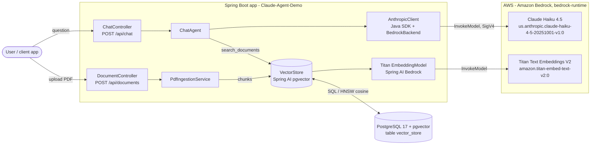
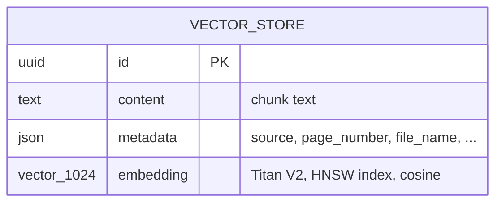
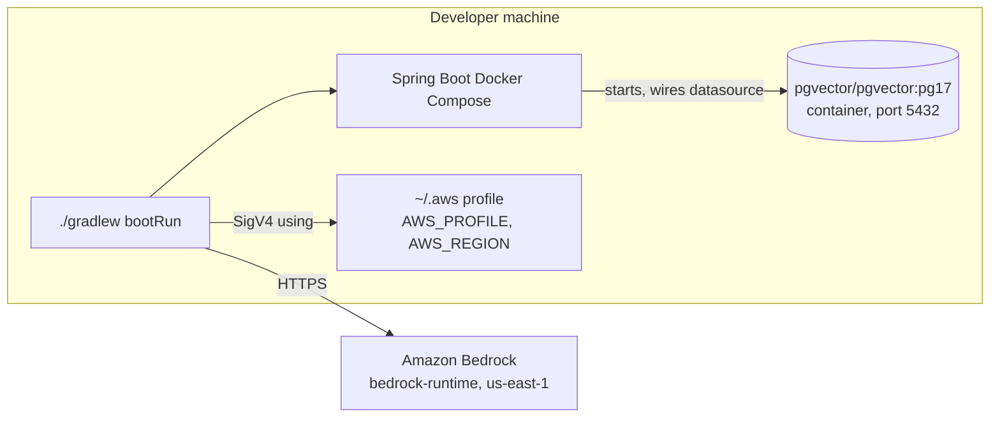

# Architecture

Claude-Agent-Demo is a Spring Boot service that answers questions about uploaded PDFs. PDFs are chunked,
embedded with Amazon Titan and stored in PostgreSQL + pgvector; a chat agent built on the Anthropic Java SDK
calls Claude on Amazon Bedrock, which searches those chunks through a tool and answers with citations.

## System context

## Components

| Component | Package / class | Responsibility |
| --- | --- | --- |
| Document API | `ingestion.DocumentController` | Accepts a multipart PDF upload, rejects non-PDF files with 400 |
| Ingestion | `ingestion.PdfIngestionService` | Reads the PDF page by page, splits pages into ~800-token chunks that overlap by 120 tokens, tags each chunk with `source` (file name) and `page_number`, replaces any earlier chunks for the same file, stores the new ones |
| Chat API | `chat.ChatController` | Accepts `{conversationId?, question}`, returns `{conversationId, answer, citations[]}` |
| Chat agent | `chat.ChatAgent` | Runs the Claude tool-use loop (max 8 turns), executes `search_documents`, returns results as `search_result` blocks with citations enabled, extracts citations from the final answer |
| Claude client | `config.ClaudeConfig` | Builds the `AnthropicClient` with `BedrockBackend` (bedrock-runtime) and the default AWS credential chain |
| Vector store | Spring AI `PgVectorStore` (auto-configured) | Embeds text through Titan on write and on query; similarity search over pgvector |
| Embedding model | Spring AI `BedrockTitanEmbeddingModel` (auto-configured) | Calls Titan Text Embeddings V2, 1024 dimensions |

## Data model

Spring AI creates the table on startup (`spring.ai.vectorstore.pgvector.initialize-schema=true`).

## Key design decisions

| Decision | Choice | Why |
| --- | --- | --- |
| Claude access | Anthropic Java SDK with `BedrockBackend` | Full Messages API (tools, citations, caching) while staying inside AWS |
| Retrieval style | Retrieval as a tool (`search_documents`) | Claude can search several times, rephrase, or split a multi-part question |
| Grounding | Results returned as `search_result` blocks with `citations.enabled=true` | Citations come back as structured data tied to source chunks, not text the model types |
| Embeddings | Titan Text Embeddings V2, 1024 dims | Runs on Bedrock in the same account; no extra vendor |
| Index | pgvector HNSW, cosine distance | Fast approximate search without a separate vector database |
| Chunking | Sliding-window token splitter (`OverlappingTokenTextSplitter`), ~800 tokens with 120-token overlap, one PDF page per source document; chunks end on a sentence boundary where possible | Overlap keeps text near a chunk boundary whole in at least one chunk; page-level splitting keeps page numbers for citations; chunk size fits well inside Titan's input limit |
| Re-ingestion | Delete chunks where `source` = file name, then insert | Uploading a changed PDF replaces it instead of duplicating it |
| Prompt caching | `cache_control` on the fixed system prompt | System prompt and tool list are identical on every request |
| Credentials | Default AWS credential chain (profile locally, IAM role in AWS) | No keys in configuration |

## Configuration

All settings are in `src/main/resources/application.properties` and can be overridden with environment variables
(for example `APP_CLAUDE_MODEL`).

| Property | Default | Purpose |
| --- | --- | --- |
| `app.aws.region` | `${AWS_REGION:us-east-1}` | Region for both Claude and Titan |
| `app.claude.model` | `us.anthropic.claude-haiku-4-5-20251001-v1:0` | Claude inference profile ID (Haiku 4.5: lowest-cost model available to the account) |
| `app.claude.max-tokens` | `16000` | Max output tokens per Claude call |
| `app.claude.effort` | empty | Effort level (`low` to `max`); leave empty for Haiku 4.5, which doesn't support it |
| `app.ingestion.chunk-size-tokens` | `800` | Target chunk size |
| `app.ingestion.chunk-overlap-tokens` | `120` | Tokens each chunk repeats from the end of the previous chunk on the same page; `0` turns overlap off, must be less than the chunk size |
| `app.retrieval.top-k` | `6` | Chunks returned per search |
| `app.retrieval.similarity-threshold` | `0.3` | Minimum similarity for a chunk to be returned |

## Runtime environment

## Current limitations

- Conversation history is kept in memory (`ConcurrentHashMap`), so it is lost on restart and not shared across instances.
- No authentication or authorization on the REST endpoints.
- A Claude refusal (`stop_reason: refusal`) returns a fixed message; there is no fallback model.
- Retrieval is vector-only; keyword (full-text) search and reranking are not implemented yet.
- Large PDFs are ingested synchronously within the upload request.
