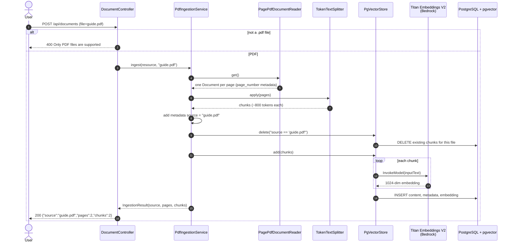
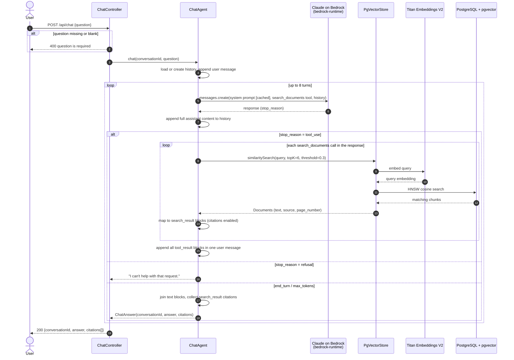
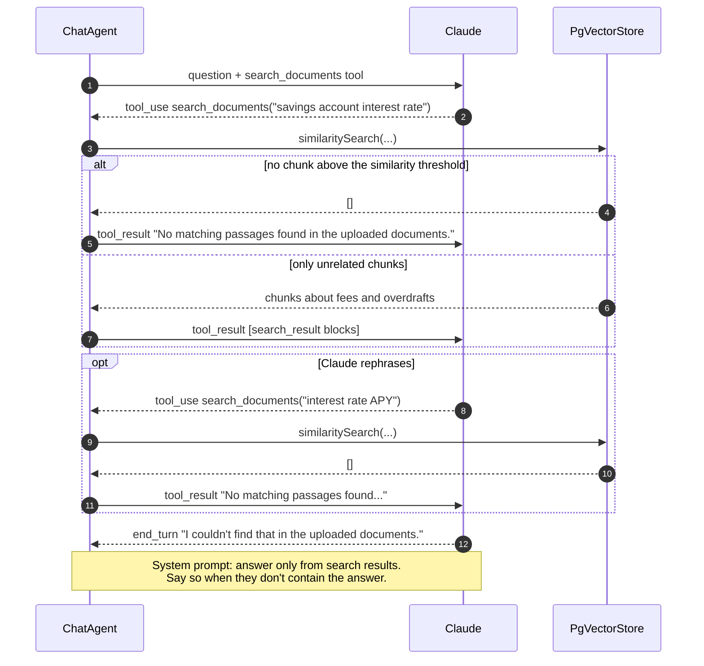
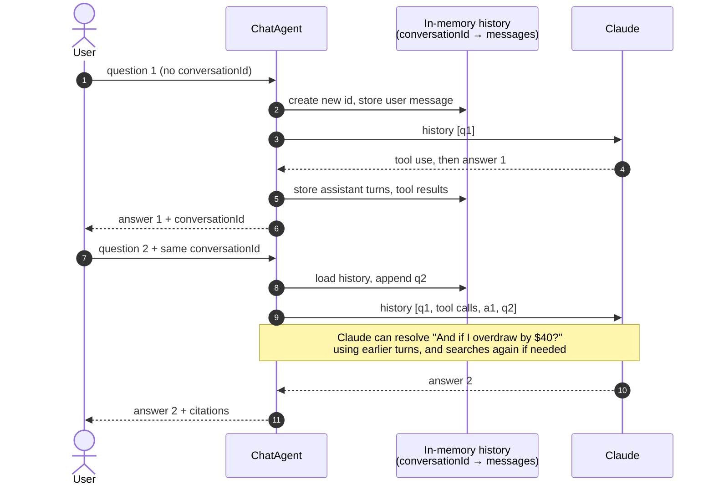

# Sequence Diagrams

These diagrams show the two request flows: uploading a PDF and asking a question. See
[architecture.md](architecture.md) for the components involved.

## 1. PDF ingestion

`POST /api/documents` (multipart, field `file`)

## 2. Asking a question (agent loop with tool use)

`POST /api/chat` with `{"conversationId": optional, "question": "..."}`

If the loop reaches 8 turns without a final answer, the agent returns "I couldn't finish answering within the
allowed number of steps."

## 3. Search results that don't answer the question

What happens when the documents don't contain the answer, e.g. "What is the savings interest rate?"

## 4. Follow-up question in the same conversation

## 5. Error paths

| Where | Error | Result returned to the caller |
| --- | --- | --- |
| Upload | File name does not end in `.pdf` | 400 `Only PDF files are supported` |
| Chat | `question` missing or blank | 400 `question is required` |
| `search_documents` | Unknown tool name, or the search throws | `tool_result` with `is_error: true`; Claude can retry or answer without it |
| Claude call | Bedrock 403 "not available for this account" / 404 "use case details have not been submitted" | 500 (exception propagates); see the troubleshooting section of the Bedrock setup guide |
| Claude call | Throttling / 5xx | SDK retries twice, then 500 |
| Claude response | `stop_reason: refusal` | 200 with "I can't help with that request." |
